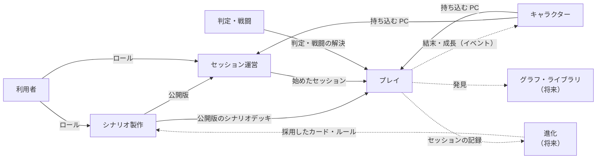

# 境界づけられたコンテキスト

[業務領域の分類](domain-map.md)の上に、境界づけられたコンテキスト（1つの言葉が1つの意味で通じる範囲）と、その間の関係（コンテキストマップ）を決める。モデルと用語をどこで分け、どこで共有し、何を受け渡すかをはっきりさせるため。ドメイン駆動設計の戦略的設計の2段階目にあたる（各コンテキストの中の設計は[集約とドメインイベント](aggregates.md)）。決めた理由・採らなかった案は[デザイナーノート](../notes/architecture/bounded-contexts.md)にある。

業務領域は問題の側で見つけるもの、コンテキストは解決の側で引く線で、1対1にはしていない。

## コンテキストの一覧

| コンテキスト | 何を扱うか | 主な言葉 | 業務領域 |
|---|---|---|---|
| シナリオ製作 | シナリオを下書きし、版を出して公開する | 下書き・版・公開・シナリオデッキ・シーン・結末・行き止まり・シナリオタイプ | シナリオ製作（中核） |
| セッション運営 | 公開版から募集を出し、応募を受け、セッションを立てて始め、中断・再開・終了させる | 募集・応募・参加者・ドライバー・ナビゲーター・GM 不在・中断・再開 | セッション運営（補完） |
| プレイ | 始めたセッションの中で、カードを場に出し、プレイし、裏返し、移す | 場・手札・プレイ・提案・裁定・語り・遷移・配る条件・使える条件 | プレイ（中核）・ソロの村（補完） |
| 判定・戦闘 | 能力値の判定と自動戦闘を解決する計算 | 能力値・判定・行動値・優先順位・戦闘の記録 | 判定・自動戦闘（補完） |
| キャラクター | PC を作り、育て、持ち物と称号を持たせる | キャラクターデッキ・CP・称号・結末タグ・解放 | キャラクター作成・成長（補完）・段階的な開示（補完） |
| 利用者 | アカウントとロール | 利用者・ロール | 認証・ユーザー管理（一般） |
| グラフ・ライブラリ（将来） | 関係性を辿り、設定を共有する | 正史グラフ・PC 発見グラフ・共有設定 | グラフ（中核）・ライブラリの共有（補完） |
| 進化（将来） | 遊んだ結果から進化候補を記録・評価・採用する | 進化候補・評価・採用・却下 | 進化ループ（中核） |

- **ソロの村はプレイに含める** — GM 不在のプレイの進め方の一種として扱う
- **判定・戦闘はプレイから独立させる** — プレイから呼ばれる計算として、セッションが無くても動く状態を保つ。数値のシミュレーション（[Webアプリの仕組み](web-app.md#自動戦闘の数値シミュレーション)）がセッション抜きで回せることを、この境界で守る

## 共有カーネル：カード

カードの定義は、利用者を除くすべてのコンテキストが共有する。仕様の原則「カードは生成元に関わらず同じ構造を持つ」（[カード・デッキの考え方](../cartagraph/card-and-deck.md)）に従うため。

- 共有するのは**カードの定義**（種類・名前・タグ・各コンテキストが読む属性）だけにする。各コンテキストは自分が読む属性だけを見る（キャラクターは CP のコスト、判定・戦闘は行動値と戦闘の効果、プレイは配る条件・使える条件、など）
- **プレイ中の状態はカードの定義に持たせない** — 表か裏か、どのゾーンにあるかは、同じカードでもセッションごとに違うので、プレイのコンテキストが持つ
- 共有カーネルを変えるときは、使うすべてのコンテキストへの影響を確かめる

## コンテキストマップ

矢印は上流から下流へ（下流が上流のモデルに合わせる）。

| 関係 | 上流 → 下流 | 受け渡すもの | 形 |
|---|---|---|---|
| 公開版 | シナリオ製作 → セッション運営・プレイ | 版番号で指す、公開したシナリオ（シナリオデッキ・シナリオタイプ・提案の扱いなど） | 公表された言語。下流は順応者で、始めたセッションは最後までその版で進む。下書きは下流に見せない |
| 始めたセッション | セッション運営 → プレイ | 参加者・GM 不在か・外したシーン・提案の扱い | 運営が立てたセッションの中身を、プレイが進める |
| 持ち込む PC | キャラクター → セッション運営・プレイ | PC（能力値・HP・キャラクターデッキ・称号） | 開始時に PC をコピーして持ち出す（[シナリオの構造と開始までの流れ](../cartagraph/scenario-flow.md)・[グラフの役割](../cartagraph/graph.md)のセッションスナップショット） |
| 結末・成長 | プレイ → キャラクター | 得た結末タグ・成長の効果 | プレイで起きたことを、キャラクターが自分のモデルに反映する。ドメインイベントの候補。GM 不在のセッションは即時に反映する |
| 判定・戦闘の解決 | 判定・戦闘 → プレイ | 判定の結果・自動戦闘の結果 | プレイは判定・戦闘の入力を渡し、結果を受け取る。判定・戦闘はプレイを知らない |
| ロール | 利用者 → 各コンテキスト | 利用者とロール | 一般の業務領域。外部サービスに置き換えても、ロールの意味は各コンテキストの側に残す |
| セッションの記録・発見・採用（将来） | プレイ → 進化・グラフ、進化 → シナリオ製作 | セッションログ・発見・採用したカードとルール | 進化ループとグラフに着手するときに決める |

## いまのコードとの対応

`packages/domain/src/` のディレクトリは仕様のページに合わせて分けてあり（[アーキテクチャルール](../process/rules/architecture.md)「packages/domain の中の置き場所」）、コンテキストとは1対1になっていない。コードを組み替えるかは、バックエンドに着手するときなどに別のプランで判断する。

| コンテキスト | いまのディレクトリ |
|---|---|
| シナリオ製作 | `scenario/`（`replay.ts` を除く） |
| セッション運営 | `session/`（`model.ts` の募集・参加者・状態、`start.ts`）・`scenario/replay.ts` |
| プレイ | `session/`（`model.ts` の場・手札・提案、`transition.ts`・`narrate.ts`・`deck.ts`）・`soloVillage/` |
| 判定・戦闘 | `check/`・`autoCombat/` |
| キャラクター | `character/`・`user/`（解放済みのカードプール） |
| 利用者 | `user/`（ロール） |
| グラフ・ライブラリ | `library/` |
| 共有カーネル（カード） | `card/` |

この方針と食い違っているところは[既知の問題](known-issues.md#ドメインモデル)にある。
