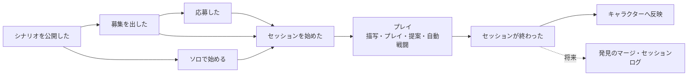

# イベントの流れ

セッション運営とプレイについて、誰が何をし（コマンド）、どの集約が受け、何が起き（イベント）、それを受けて何をするか（ポリシー）を、時間の順に並べる。ドメイン駆動設計のイベントストーミングの結果にあたる。[集約とドメインイベント](aggregates.md)・[中核のユースケース](use-cases.md)を、1回の遊びの流れとして通して読めるようにし、抜けを見つけるため。決めた理由と、見つけた抜けは[デザイナーノート](../notes/architecture/event-flows.md)にある。

## 書き方

| 要素 | 意味 | 例 |
|---|---|---|
| アクター | コマンドを出す人。GM 不在のセッションで GM の代わりに進める「システム」を含む | GM・ドライバー・システム |
| コマンド | アクターがしたいこと | セッションを始める |
| 集約 | コマンドを受けて、不変条件を守って変わるもの（[集約の一覧](aggregates.md#集約の一覧)） | 募集 |
| イベント | 起きたこと。過去形 | セッションを始めた |
| ポリシー | 「〜が起きたら〜する」。ほかの集約・コンテキストへの反映 | セッションスナップショットを作る |
| 読みモデル | コマンドを出す前に、アクターや検査が見るもの | シナリオ集 |

- 集約やコンテキストをまたぐイベントと、受け取る側の振る舞いの正は[ドメインイベント](aggregates.md#ドメインイベント)。このページは順番とつながりを示し、またがないイベント（集約の中で完結するもの）もあわせて並べる
- ルールの細部は仕様のページが正。ここには書き写さない

## 範囲

シナリオ製作は、公開まわりのイベントを入口としてだけ出す。グラフ・進化ループは将来のコンテキストなので、プレイから渡すもの（点線）だけを出す。

## 1. 始めるまで

| アクター | コマンド | 集約 | イベント | ポリシー・読みモデル |
|---|---|---|---|---|
| シナリオ製作者 | 公開する・シナリオ集から外す | シナリオ | シナリオを公開した・シナリオ集から外した | 読みモデル「シナリオ集」が変わる。載っている公開版からだけ、募集とソロ開始ができる |
| GM | 募集を出す（通常／GM 不在） | 募集 | 募集を出した | 出したときの公開版の版番号を持つ。読みモデル「受付中の募集」に出る |
| PL | 応募する | 募集 | 応募した | 応募の前に、読みモデル「PC が持つ結末タグ」で再挑戦不可を確かめる。GM 不在の募集には応募しない |
| GM | セッションを始める（通常の募集） | 募集 | セッションを始めた | 開始の時点でも再挑戦不可を確かめ直す。募集は開始済みになり、受付中の募集から消える |
| PL | 自分の PC で始める（GM 不在の募集） | 募集 | セッションを始めた | 自分が所有者の PC だけ。募集は受付中のまま残る |
| PL | ソロで始める（シナリオの公開版から） | （キャラクター・セッション） | キャラクターを作った・セッションを始めた | 名前から新しい PC を作り、その PC で始める |

「セッションを始めた」を受けて、セッションとセッションスナップショットを同じ id で作り、参加する PC をコピーして持ち出す（[ドメインイベント](aggregates.md#ドメインイベント)）。

## 2. プレイを進める

| アクター | コマンド | 集約 | イベント | ポリシー・読みモデル |
|---|---|---|---|---|
| GM | 描写を書き、選択肢を配る・取り下げる | セッションスナップショット | 描写した・選択肢を配った・取り下げた | GM 不在のセッションでは出さない（システムが配る条件で配る） |
| ドライバー | 手札のカードをプレイする | セッションスナップショット | カードをプレイした・シーンを移った | 移り先のある選択肢なら、移り先の選択肢で手札を配り直す。承認待ちの提案は「今回は使われなかった」になる |
| ドライバー | （結末のノードへ移る） | セッションスナップショット | 結末に達した | どのセッションでも、最後に入った結末として残す。GM 不在のセッションなら、その場で終わる（4へ） |
| GM | カードを明かす（存在・中身）、状態タグを変える | セッションスナップショット | カードを明かした | 将来、明かしたものが PL の発見になる（GR-5 で発見グラフへ取り込む） |
| GM | 通常進行とじっくり進行を切り替える | セッションスナップショット | 進行を切り替えた | — |
| ナビゲーター | ドライバーに助言する | — | — | 何も書き換えない |

読みモデル：語りの記録（描写とプレイの履歴）・場と手札。

## 3. 提案と裁定、中断と再開

| アクター | コマンド | 集約 | イベント | ポリシー・読みモデル |
|---|---|---|---|---|
| ドライバー | 新たな選択肢を提案する | セッションスナップショット | 提案が出た | 提案の扱いが自動解決なら、システムがすぐ裁定する。GM 不在の募集から始めたセッションで「GM が後から裁定」なら、セッションを中断する |
| GM（自動解決ならシステム） | 提案を採用する・却下する | セッションスナップショット | 提案を裁定した | 裁定待ちの中断は、再開できる状態になる |
| ドライバー・GM | 中断する | セッション | セッションを中断した | 再開するまで、カードのプレイと提案を止める |
| ドライバー・GM | 再開する | セッション | セッションを再開した | 裁定待ちの中断は、GM が裁定するまで再開できない |

読みモデル：裁定待ちの提案（GM が見る）・中断中のセッション（GM が絞り込む）。

## 4. GM 不在のセッションの進行

GM 不在のセッション（[GM不在のソロの進行](../cartagraph/solo-village.md)、仮ルール）だけで起きるもの。ここの反映は、セッションの終わりを待たない即時反映（[即時反映](../cartagraph/solo-village.md#即時反映例外)）。

| アクター | コマンド | 集約 | イベント | ポリシー・読みモデル |
|---|---|---|---|---|
| システム | （ノードに入る） | セッションスナップショット | 選択肢を配った | 配る条件を満たす選択肢だけを配る。使える条件を満たさないカードはプレイできない |
| ドライバー | 成長の効果のあるカードをプレイする | セッションスナップショット | 成長した | 能力値・カードの増減を、キャラクターへ即時に反映する |
| ドライバー | 自動戦闘を解決する | セッションスナップショット | 自動戦闘に勝った・自動戦闘に敗れた | 勝てば選択肢を配る。初めて敗れたら「再挑戦の記憶」をキャラクターへ即時に足す |
| システム | （結末に達した） | セッション | セッションが終わった | 結末タグをドライバーのキャラクターへ即時に付ける |
| システム | （どの選択肢にも移り先が無い） | セッションスナップショット | 描写した | カードの説明文を描写として返し、同じシーンに留まる |

## 5. 終わる

| アクター | コマンド | 集約 | イベント | ポリシー・読みモデル |
|---|---|---|---|---|
| GM | 終了を宣言する | セッション | セッションが終わった | 承認待ちの提案を「今回は使われなかった」で閉じる。参加したすべての PC へ結果を反映する（下記） |
| （受け取る側） | — | キャラクター | カードを得た | 解放済みカードプールに足す |

- **反映する結果** — 最後に入った結末の結末タグ（結末のノードに入らずに終わったら付かない。[PCの貸し借りとフィードバック](../cartagraph/party-and-session.md#pcの貸し借りとフィードバック)）。発見のマージ（GR-5）とセッションログ（進化ループ）は将来
- **破棄** — セッションスナップショットごと捨てる終わり方（[グラフの役割](../cartagraph/graph.md#セッションスナップショットとマージ)）は、誰がいつ行うかが決まっていない（[未解決論点](../open-questions.md#仕様の細部の未決)）。この流れには載せていない

## いまのコードとの対応

コマンドは MSW のハンドラ（`apps/web/src/mocks/handlers.ts`）が1つずつ受け、イベントは返さず、ポリシーにあたる反映もその場で書き換えている（[集約とドメインイベントのいまのコードとの対応](aggregates.md#いまのコードとの対応)）。この流れと食い違っているところは次のとおり。

- **ソロで始めるが、1回の操作で2つの集約（キャラクターとセッション）を作る** — 集約をまたぐ整合の取り方は、イベントの届け方とあわせて決める（[要望](../backlog/ddd-application.md)）
- **GM 不在でないセッションは、入った結末を残していない** — [既知の問題](known-issues.md#gm不在でないセッションで結末タグが-pc-に反映されない)
- **任意の中断が無く、再開はドライバーにしかできない** — [既知の問題](known-issues.md#中断と再開の権限が仕様と食い違っている)
- **終了の宣言と提案の裁定で、GM 本人かを確かめていない** — [既知の問題](known-issues.md#提案の採用却下でgm-本人かを確かめていない)
- **「カードを得た」から解放済みカードプールへ足す処理が無い** — 解放済みカードプールはモックの固定値
