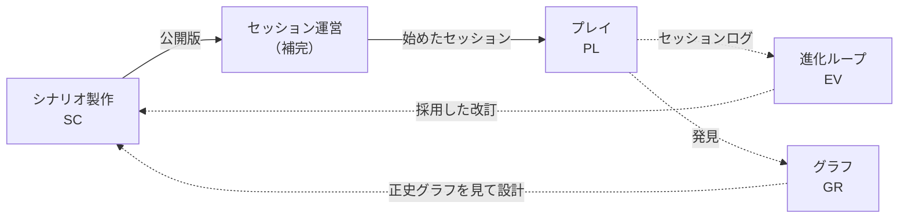

# 中核のユースケース

[業務領域の分類](domain-map.md)で中核にした4つの業務領域（シナリオ製作・プレイ・グラフ・進化ループ）について、誰が何を成し遂げるか（ユースケース）を、[集約とドメインイベント](aggregates.md)の言葉で並べる。仕様のページに散らばった振る舞いを、利用者の目的の単位で通して読めるようにするため。振る舞いの正は各仕様のページで、このページは目的ごとの索引と流れの要約にとどめる（ルールの細部は書き写さず、リンクする）。決めた理由は[デザイナーノート](../notes/architecture/use-cases.md)にある。

## 書き方

- **1つのユースケースは、1人のアクターが1回の操作で成し遂げる1つの目的** — 1回の操作で書き換える集約は1つ（[集約の書き方の方針](aggregates.md#書き方の方針)）。ほかの集約への反映は、結果のイベントで表す
- **項目** — アクター・前提・主な流れ・ほかの流れ（断る・分かれる）・結果（書き換える集約と起きるイベント）
- **アクター** — [4つのロール](../cartagraph/graph.md#グラフの利用者とロール別の見え方)（システム製作者・シナリオ製作者・GM・PL）と、セッションの中の役割（[ドライバー・ナビゲーター](../cartagraph/party-and-session.md#ドライバーとナビゲーター)）。GM 不在のセッションでは、GM の代わりに進める「システム」もアクターに数える
- **補完の業務領域は名前だけ** — 募集・セッションの開始・中断・再開（セッション運営）や、キャラクターへの反映は、中核のユースケースの前提・結果として名前だけ出す

## 全体の流れ

中核の4つは、遊ぶたびに1周するループになる。点線は将来のコンテキスト（グラフ・進化）へのつながり。

## シナリオ製作

主なアクターはシナリオ製作者。集約はシナリオと版（[集約の一覧](aggregates.md#集約の一覧)）。仕様は[シナリオの構造と開始までの流れ](../cartagraph/scenario-flow.md)・[シナリオタイプ](../cartagraph/scenario-type.md)。

| ID | ユースケース | アクター | 書き換える集約 | 起きるイベント |
|---|---|---|---|---|
| SC-1 | 下書きを作る | シナリオ製作者 | シナリオ | — |
| SC-2 | シナリオデッキを組む | シナリオ製作者 | シナリオ | — |
| SC-3 | 結末と結末タグを決める | シナリオ製作者 | シナリオ | — |
| SC-4 | シナリオの目印を決める | シナリオ製作者 | シナリオ | — |
| SC-5 | 行き止まりを見つける | シナリオ製作者・GM | （読むだけ） | — |
| SC-6 | シナリオ集へ公開する・公開し直す | シナリオ製作者 | シナリオ | シナリオを公開した |
| SC-7 | シナリオ集から外す | シナリオ製作者 | シナリオ | シナリオ集から外した |
| SC-8 | 公開した版を読む | GM・PL | （読むだけ） | — |

### SC-1 下書きを作る

- **前提** — シナリオ製作者のロールを持つ
- **主な流れ** — 題名と概要を決めて、新しいシナリオを作る。下書きは書きかけでもよく、製作者だけが読み書きできる
- **結果** — シナリオができる。一度も公開していないので、シナリオ集には載らない

### SC-2 シナリオデッキを組む

- **主な流れ** — [シナリオデッキ](../cartagraph/card-and-deck.md#シナリオデッキ例)に、導入・シーン・結末のノード（入れ子にできる）と、NPC・情報・エネミー・ロケーションのカードを置く。シーンには選択肢カードを置き、移り先のノード（別のシーンか結末）を指す（[次のシーンへ進む](../cartagraph/play-and-field.md#次のシーンへ進む)）
- **ほかの流れ** — ほかの選択肢カードの移り先として指されているノードは消せない（どこから指されているかを示して断る）。ノードを消すと、その子孫も消える
- **結果** — シナリオの下書きが変わる。公開し直すまで、GM・PL には届かない

### SC-3 結末と結末タグを決める

- **主な流れ** — 結末を足す（結末と、それを指す結末のノードが対でできる）。結末の数は2つに限らない。結末ごとに、配る[結末タグ](../cartagraph/scenario-flow.md#連作キャンペーンの表現結末タグ)と、再挑戦不可を付けられる
- **ほかの流れ** — 結末タグを配らない結末には、再挑戦不可を付けられない。移り先として指されている結末は消せない
- **結果** — シナリオの下書きが変わる。後から再挑戦不可を付け外ししても、既に結末タグのカードを持つ PC には及ばない

### SC-4 シナリオの目印を決める

- **主な流れ** — GM・PL がシナリオを選ぶための[メタデータ](../cartagraph/scenario-flow.md#シナリオのメタデータ)（シナリオタイプ・前提タグ・想定人数・空間モデル・提案の扱い方・推奨 CP）を決める
- **ほかの流れ** — 「戦闘なし」と宣言したのに戦闘のシーンや空間モデルがあると、SC-6 の検査で止まる（保存は止めない）
- **結果** — シナリオの下書きが変わる

### SC-5 行き止まりを見つける

- **主な流れ** — 先へ進む選択肢の無いシーン（導入・シーンのノードで、移り先を持つ選択肢カードが1枚も無いもの）を挙げる。GM 不在のセッションでは、ここで先へ進めなくなる（[GMレスセッションでの選択肢の描写](../cartagraph/play-and-field.md#gmレスセッションでの選択肢の描写)）
- **ほかの流れ** — GM が募集を出すときにも、外したシーンを除いたデッキで同じものを挙げる。どちらも止めず、注意として見せる
- **結果** — 何も書き換えない。製作者は SC-2 で選択肢を足すかを決める

### SC-6 シナリオ集へ公開する・公開し直す

- **主な流れ** — 下書きを検査（シーンのつながり・参照の整合・シナリオタイプと中身の食い違い）し、通れば下書きの中身で新しい版を作る。版番号は1ずつ増え、いちばん新しい版が公開版になる（[シナリオの公開](../cartagraph/scenario-flow.md#シナリオの公開)）
- **ほかの流れ** — 検査に通らなければ公開しない（理由を示す）。シナリオ集から外したシナリオを公開すると、シナリオ集に戻る
- **結果** — シナリオの最新の版番号が増え、シナリオ集に載る。「シナリオを公開した」が起き、版ができる。既にある募集・セッションは前の版のまま進む

### SC-7 シナリオ集から外す

- **主な流れ** — 公開版をシナリオ集から外す
- **結果** — 「シナリオ集から外した」が起き、新しい募集とソロ開始ができなくなる。既にある募集とセッションは残り、既にある募集からは始められる（GM 不在の募集からは、外した後も始められる）

### SC-8 公開した版を読む

- **主な流れ** — シナリオ集から、公開版と前の版を読む。GM は読んでから募集を出す（セッション運営へ）
- **ほかの流れ** — 下書きは読めない（製作者だけ）

## プレイ

主なアクターはドライバーと GM。GM 不在のセッションでは GM の代わりにシステムが進める。集約はセッションスナップショット（セッションと同じ id で1対1）。仕様は[場・手札・プレイ](../cartagraph/play-and-field.md)・[カードの裏表](../cartagraph/card-face-back.md)・[パーティー編成と非同期セッション参加](../cartagraph/party-and-session.md)・[GM不在のソロの進行](../cartagraph/solo-village.md)。

前提はすべて共通：セッション運営がセッションを始めている（版のシナリオデッキと、コピーした PC を持ち出してある）。

| ID | ユースケース | アクター | 書き換える集約 | 起きるイベント |
|---|---|---|---|---|
| PL-1 | 描写を書き、選択肢を配る・取り下げる | GM | セッションスナップショット | — |
| PL-2 | 手札のカードをプレイする | ドライバー | セッションスナップショット | 結末に達した・成長した |
| PL-3 | 新たな選択肢を提案する | ドライバー | セッションスナップショット | 提案が出た |
| PL-4 | 提案を裁定する | GM（自動解決ならシステム） | セッションスナップショット | 提案を裁定した |
| PL-5 | カードを明かす | GM | セッションスナップショット | — |
| PL-6 | 自動戦闘を解決する | ドライバー | セッションスナップショット | — |
| PL-7 | 濃密モードに切り替える | GM | セッションスナップショット | — |
| PL-8 | ドライバーに助言する | ナビゲーター | — | — |

### PL-1 描写を書き、選択肢を配る・取り下げる

- **主な流れ** — GM が、いまの状況を描写として書き、ドライバーの手札に選択肢カードを配る。配る選択肢カードは、シナリオデッキにあるものでも、その場で作るもの（移り先を指せる）でもよい（[選択肢カードとGMの生成](../cartagraph/play-and-field.md#選択肢カードとgmの生成)）
- **ほかの流れ** — 一時的に渡した選択肢カードは、プレイされる前なら取り下げられる。GM 不在のセッションでは GM はこれをしない（システムが[配る条件](../cartagraph/solo-village.md#配る条件使える条件)で配る）
- **結果** — 手札と語りの記録が変わる

### PL-2 手札のカードをプレイする

- **前提** — ドライバーである（カードをプレイできるのはドライバーだけ）
- **主な流れ** — 手札から1枚を選んでプレイする。効果は[基本操作セット](../cartagraph/play-and-field.md#基本操作セット)の組み合わせで、移り先を持つ選択肢カードなら、そのノードへ移り、手札の選択肢カードは移り先のもので配り直される
- **ほかの流れ**
  - 移り先の無い選択肢カードは、GM 不在でないセッションでは GM の描写（PL-1）を待つ。GM 不在のセッションでは、システムがカードの説明文を描写として返し、そのカードだけを手札から消して同じシーンに留まる
  - 結末のノードへ進むと、GM 不在のセッションではその場で終わる。GM 不在でないセッションでは、GM が終了を宣言するまで続く（終了はセッション運営）
  - GM 不在のソロでは、成長の効果（能力値を上げる・カードを手放す）もある
- **結果** — いまのシーン・手札・場・語りの記録が変わる。結末に進めば「結末に達した」、成長の効果があれば「成長した」が起き、GM 不在のセッションならキャラクターへ即時に反映する

### PL-3 新たな選択肢を提案する

- **前提** — 提案の扱いが「提案不可」でない（提案不可なら、[新たな選択肢を提案](../cartagraph/play-and-field.md#新たな選択肢を提案カード)カードが手札に無い）
- **主な流れ** — ドライバーが「新たな選択肢を提案」カードをプレイし、したいこと（例：扉を壊したい）を書く。提案は承認待ちになる。元の選択肢は手札に残り、裁定を待たずに選んで進んでもよい（[提案の裁定待ちの間の状態遷移](../cartagraph/play-and-field.md#提案の裁定待ちの間の状態遷移)）
- **ほかの流れ** — GM 不在の募集から始めたセッションで「GM が後から裁定」なら、セッションは中断し、元の選択肢も選べない。提案の扱いが自動解決なら、すぐに PL-4 へ進む
- **結果** — 提案が増える。「提案が出た」が起き、上の中断ならセッション運営がセッションを中断（裁定待ち）にする

### PL-4 提案を裁定する

- **前提** — 承認待ちの提案がある
- **主な流れ** — GM が提案を採用して選択肢カードにする（移り先を付けられる）か、理由を付けて却下する。採用したカードはドライバーの手札に配られる
- **ほかの流れ**
  - 自動解決のシナリオをソロ開始したセッションでは、システムが提案文をそのまま採用する（[GMレスセッションでの提案の扱い](../cartagraph/play-and-field.md#gmレスセッションでの提案の扱い)）
  - 裁定の前にドライバーが別の選択肢で先へ進んでいたら、採用しても「今回は使われなかった」扱いになる
  - 却下した提案は消さず、理由とともに PL に見える形で残る
- **結果** — 提案の状態が、承認待ちから採用・却下へ移る（戻らない）。「提案を裁定した」が起き、裁定待ちの中断は再開できる状態になる（再開はセッション運営）

### PL-5 カードを明かす

- **主な流れ** — GM が、GM 専用ゾーンのカードを PL 可視ゾーンへ移す（存在を明かす）か、PL 可視ゾーンの裏向きのカードを表にする（中身を明かす）（[場のゾーン構造](../cartagraph/card-face-back.md#場のゾーン構造)）。状態タグ（友好度・生存など）の変更も、ここに含める
- **結果** — 場のカードの見え方が変わる。将来は、明かしたものが PL の発見になる（GR-4）

### PL-6 自動戦闘を解決する

- **前提** — GM 不在のセッションで、いまのシーンが自動戦闘のシーン（[自動戦闘](../cartagraph/auto-combat.md)、仮ルール）
- **主な流れ** — ドライバーが戦い方（行動の優先順位）を決める。プレイは判定・戦闘のコンテキストに PC と敵を渡し、決着までの結果を受け取る
- **結果** — 自動戦闘の状態と戦闘の記録が変わる。勝敗に応じて先へ進む。敗れたときの扱いは[勝敗の扱い](../cartagraph/auto-combat.md#勝敗の扱い)

### PL-7 濃密モードに切り替える

- **主な流れ** — GM が、しっかり戦う・NPC と細かくやり取りする場面で、軽量モードと濃密モードを切り替える（[軽量モードと濃密モード](../cartagraph/party-and-session.md#軽量モードと濃密モード)）。シナリオ製作者がシーンにあらかじめ指定しておくことも、戦闘イベントカードなどが要求することもある
- **ほかの流れ** — GM 不在のソロの自動戦闘（PL-6）は、濃密モードにしない
- **結果** — セッションのモードが変わる

### PL-8 ドライバーに助言する

- **主な流れ** — ナビゲーターが会話や提案でドライバーを助ける。カードを選んでプレイする権限は持たない
- **結果** — 何も書き換えない。助言を受けてプレイするのはドライバー（PL-2・PL-3）

## グラフ（将来）

カードの関係性を辿るグラフ。正史グラフ（シナリオ単位）と PC 発見グラフ（PC 単位）に分かれる（[グラフの役割](../cartagraph/graph.md)）。集約は着手するときに決める（[集約の一覧](aggregates.md#集約の一覧)）。グラフはゲームの進行（判定・分岐・解放）には使わない。

| ID | ユースケース | アクター | 起きること |
|---|---|---|---|
| GR-1 | システム全体の構造を見る | システム製作者 | — |
| GR-2 | 正史グラフを見ながらシナリオを設計する | シナリオ製作者 | — |
| GR-3 | セッションの進み具合を重ねて見る | GM | — |
| GR-4 | セッション後に、発見したものを辿る | PL | — |
| GR-5 | 発見を PC 発見グラフへ取り込む | （セッションの正常終了） | PC 発見グラフが増える |
| GR-6 | 正史グラフへ正式に採用する | GM・シナリオ製作者 | 正史グラフが変わる |
| GR-7 | 共有設定へ格上げする | システム製作者・シナリオ製作者 | 共有設定ができる |

- **GR-1〜GR-4 は同じグラフの絞り込み** — 1つのグラフを、ロールと進み具合に応じた権限で絞って見せる。PL だけは体験を重んじた専用の見せ方にする（[可視範囲の実現方法](../cartagraph/graph.md#可視範囲の実現方法)）。PL はセッション中にグラフを触らず、カードの操作だけで遊ぶ（[PLの探索体験](../cartagraph/graph.md#plの探索体験)）
- **GR-4 は中断したセッションの思い出しも兼ねる** — どこまで発見していたかを辿る
- **GR-5 は正常終了のときだけ** — セッション中の開示はまずセッションスナップショットに残り、正常に終わったら差分を PC 発見グラフへ取り込む。破棄したセッションは何も残さない（[セッションスナップショットとマージ](../cartagraph/graph.md#セッションスナップショットとマージ)）。発見はパーティーで共有し、GM が「この PC だけが知る」と印を付けたものだけ PC ごとに分ける
- **GR-6 は自動では起きない** — PL の発見は正史グラフを変えない。GM・シナリオ製作者が判断したときに初めて変わる。正史グラフがシナリオの下書きと版のどちらに当たるかは[未解決論点](../open-questions.md#次に詰める候補)
- **GR-7 は進化ループに乗る** — 格上げの判断は EV-4 の流れで行い、共有設定は新しいシナリオの土台（テンプレート）になる。既にあるシナリオのカードは書き換えない（[正史グラフの共有設定への格上げ](../cartagraph/graph.md#正史グラフの共有設定への格上げ)）

## 進化ループ（将来）

遊んだ結果から進化候補を記録・評価・採用し、システム・シナリオ・世界設定・GM ガイドなどを改訂する（[進化ループ](../concept/index.md#進化ループ)）。集約は着手するときに決める（候補は1件の進化候補。データの項目は[進化候補のデータ項目](../concept/index.md#進化候補のデータ項目)）。進化候補を自動で正式に採用することはしない。

| ID | ユースケース | アクター | 進化候補のステータス |
|---|---|---|---|
| EV-1 | セッションログに印を付ける | 誰でも | — |
| EV-2 | 進化候補を記録する | GM・PL（後から誰でも） | 新規 |
| EV-3 | 似た候補を一覧する | 誰でも | — |
| EV-4 | 評価に上げ、コメントを足す | 誰でも | 新規 → 評価中 |
| EV-5 | 採用・却下を判断する | システム製作者・シナリオ製作者 | 評価中 → 採用・却下 |
| EV-6 | 採用した候補で改訂する | システム製作者・シナリオ製作者 | 採用 |

### EV-1 セッションログに印を付ける

- **前提** — セッションログ（自然言語の完全な記録）が残っている（[セッションログの方針](../concept/index.md#セッションログの方針)）
- **主な流れ** — ログを読み返し、シナリオからの逸脱・その場の裁定などに、後から構造化した情報を付ける
- **結果** — ログそのものは書き換えず、印が増える

### EV-2 進化候補を記録する

- **主な流れ** — セッションの後、気づいたことを1件の進化候補として記録する。概要・カテゴリ（[問題／改善／発見／創発／逸脱／成功／再利用](../concept/index.md#進化候補は問題だけではない)）・元のセッションログへの参照・タグを付ける。問題だけでなく、うまくいったことも記録する
- **ほかの流れ** — 第三者（システム製作者など）が、後からログを読んで記録してもよい
- **結果** — 新規の進化候補ができる

### EV-3 似た候補を一覧する

- **主な流れ** — タグで同じ候補を一覧し、複数のセッションで再び起きているかを見る（[複数セッションでの再発の検知](../concept/index.md#複数セッションでの再発の検知)）。却下した候補も、過去の理由とともに出る
- **結果** — 何も書き換えない。再発は汎用性の裏付けとして EV-4・EV-5 で参照する

### EV-4 評価に上げ、コメントを足す

- **主な流れ** — 「良さそうだ」と思った候補を評価に上げる。再発の回数は条件にしない。発見者・参加者は評価のコメントを足せる
- **結果** — 進化候補が評価中になり、コメントが参考として溜まる

### EV-5 採用・却下を判断する

- **前提** — システム製作者・シナリオ製作者である（[評価・採用判断の主体](../concept/index.md#評価採用判断の主体)）
- **主な流れ** — 面白さ・汎用性・プレイヤーの評価を観点に、自由に判断し、理由を書く。ルールなら基本・オプション・シナリオ固有のどれにするか、シナリオなら正式な分岐・別ルート・シナリオ固有の要素のどれにするかを決める（[進化ループ](../concept/index.md#進化ループ)）
- **ほかの流れ** — 却下しても消さず、理由とともに残す。同じ提案がまた出たら、過去の理由を踏まえて評価し直す
- **結果** — 進化候補が採用・却下になる。点数で機械的に決めることはしない

### EV-6 採用した候補で改訂する

- **主な流れ** — 採用した候補をもとに、システム・シナリオ・世界設定・GM ガイドなどを改訂する。シナリオなら、製作者が下書きを直して公開し直す（SC-2・SC-6）。グラフの共有設定への格上げもこの流れに乗る（GR-7）
- **結果** — 改訂したものが次のセッションで遊ばれ、また経験が溜まる（ループの1周）
